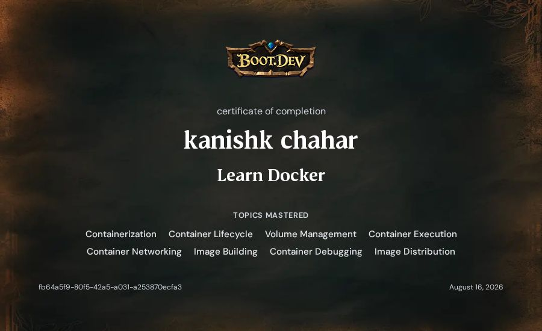
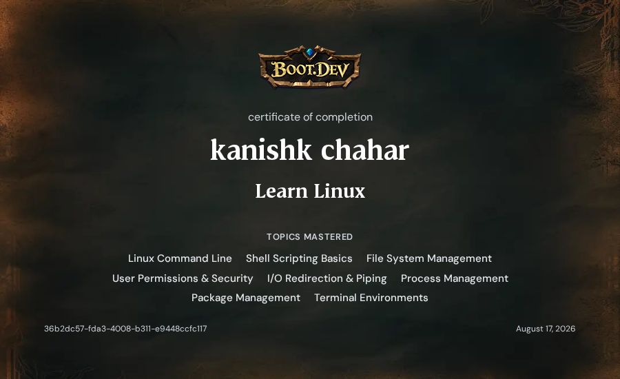
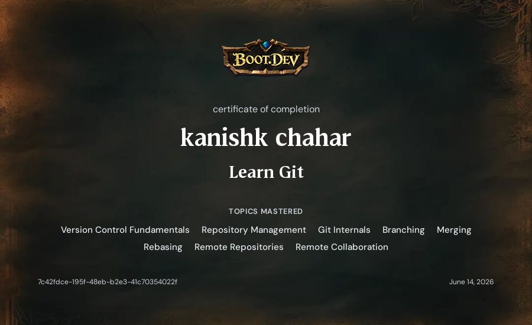

<h1 align="center">Kanishk Chahar</h1>
<h4 align="center">DevOps · Cloud Infrastructure · CI/CD · Linux Systems</h4>

  

  
  &nbsp;&nbsp;
  
  &nbsp;&nbsp;
  
  &nbsp;&nbsp;
  

---

<h3 align="center">About</h3>

  Engineering student focused on <strong>DevOps, cloud infrastructure, and automation</strong>. 
  I build CI/CD workflows, containerize applications, and make Linux systems easier to operate.

  🌱 Learning <strong>Kubernetes, AWS, and GitOps</strong> 
  🐧 Daily driving <strong>Arch Linux</strong> and working with Bash 
  🏗️ Exploring <strong>Terraform and Ansible</strong> for infrastructure provisioning 
  🤝 Open to <strong>DevOps, Cloud, and SRE</strong> opportunities

---

<h3 align="center">Tech Stack</h3>

<strong>Cloud &amp; Infrastructure</strong>

<table align="center">
  <tr>
    <td align="center" width="140" height="100"><picture><source srcset="https://techstack-generator-tsg.vercel.app/aws-icon.svg" type="image/svg+xml"></picture> <strong>AWS</strong></td>
    <td align="center" width="140" height="100"> <strong>Terraform</strong></td>
    <td align="center" width="140" height="100"> <strong>Ansible</strong></td>
    <td align="center" width="140" height="100"><picture><source srcset="https://techstack-generator-tsg.vercel.app/kubernetes-icon.svg" type="image/svg+xml"></picture> <strong>Kubernetes</strong></td>
  </tr>
</table>

<strong>Containers &amp; Delivery</strong>

<table align="center">
  <tr>
    <td align="center" width="140" height="100"><picture><source srcset="https://techstack-generator-tsg.vercel.app/docker-icon.svg" type="image/svg+xml"></picture> <strong>Docker</strong></td>
    <td align="center" width="140" height="100"> <strong>GitHub Actions</strong></td>
    <td align="center" width="140" height="100"><picture><source srcset="https://techstack-generator-tsg.vercel.app/nginx-icon.svg" type="image/svg+xml"></picture> <strong>Nginx</strong></td>
  </tr>
</table>

<strong>Systems &amp; Development</strong>

<table align="center">
  <tr>
    <td align="center" width="140" height="100"> <strong>Arch Linux</strong></td>
    <td align="center" width="140" height="100"> <strong>Bash</strong></td>
    <td align="center" width="140" height="100"><picture><source srcset="https://techstack-generator-tsg.vercel.app/python-icon.svg" type="image/svg+xml"></picture> <strong>Python</strong></td>
    <td align="center" width="140" height="100"> <strong>Git</strong></td>
    <td align="center" width="140" height="100"><picture><source srcset="https://techstack-generator-tsg.vercel.app/github-icon.svg" type="image/svg+xml"></picture> <strong>GitHub</strong></td>
  </tr>
  <tr>
    <td align="center" width="140" height="100"><picture><source srcset="https://techstack-generator-tsg.vercel.app/js-icon.svg" type="image/svg+xml"></picture> <strong>JavaScript</strong></td>
    <td align="center" width="140" height="100"><picture><source srcset="https://techstack-generator-tsg.vercel.app/ts-icon.svg" type="image/svg+xml"></picture> <strong>TypeScript</strong></td>
    <td align="center" width="140" height="100"><picture><source srcset="https://techstack-generator-tsg.vercel.app/mysql-icon.svg" type="image/svg+xml"></picture> <strong>MySQL</strong></td>
    <td align="center" width="140" height="100"><picture><source srcset="https://techstack-generator-tsg.vercel.app/restapi-icon.svg" type="image/svg+xml"></picture> <strong>REST APIs</strong></td>
  </tr>
</table>

<strong>Detailed Breakdown</strong>

| Domain | Technologies |
| :---: | :---: |
| **Containers & Orchestration** | Docker · Docker Compose · Multi-stage Builds · Kubernetes |
| **CI/CD & Automation** | GitHub Actions · Automated Testing · Build Pipelines · Bash |
| **Cloud & IaC** | AWS (EC2, S3, IAM) · Terraform · Ansible |
| **Operating Systems** | Arch Linux · Debian · Ubuntu · Systemd · Process Management |
| **Monitoring** | Prometheus · Grafana · Log Aggregation · Alerting |
| **Networking** | Wireshark · DNS (A, AAAA, MX, NS, TXT, SOA) · TCP/IP |
| **Version Control** | Git · GitHub · Branching Strategies · Code Review |

---

<h3 align="center">Certifications</h3>

  &nbsp;&nbsp;
  &nbsp;&nbsp;
  

<table align="center">
  <tr>
    <td align="center" width="33%">
      
       Boot.dev · Docker
    </td>
    <td align="center" width="33%">
      
       Boot.dev · Linux
    </td>
    <td align="center" width="33%">
      
       Boot.dev · Git
    </td>
  </tr>
</table>

---

  Open to collaboration — reach out via <a href="https://www.linkedin.com/in/kanishk-chahar34" target="_blank">LinkedIn</a> or <a href="mailto:kanishkchahar34@gmail.com">email</a>.

